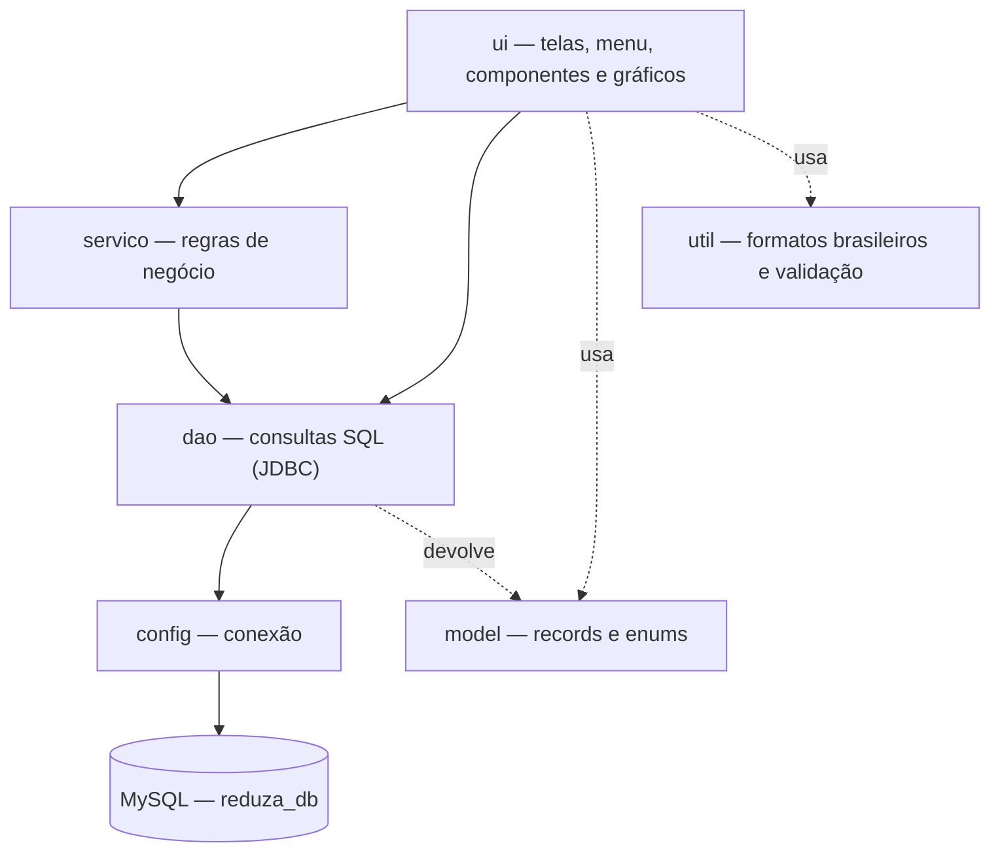

# Reduza — Documentação técnica do protótipo

Versão 1.0.0-protótipo · Grupo DevNexus · UPX2 · Facens · outubro de 2026

---

## 1. Visão geral

O Reduza é uma aplicação desktop em Java que registra resíduos por setor e categoria, compara períodos, acompanha metas de redução e mostra o impacto em reais. O protótipo cobre o fluxo completo, do cadastro ao painel. Os dados de exemplo são fictícios.

| Item | Valor |
|---|---|
| Linguagem | Java 17+ (compila com `--release 17`) |
| Interface | Swing com componentes e gráficos próprios (Java2D) |
| Banco | MySQL 8 / MariaDB 10.5+ via JDBC |
| Dependências | `mysql-connector-j` 8.4.0 (execução) e JUnit 5 (testes) |
| Tamanho | 68 arquivos Java (~5.900 linhas) + 4 classes de teste |

---

## 2. Arquitetura

O código é organizado em camadas. Cada camada só conversa com a de baixo:



| Pacote | Responsabilidade | Exemplos |
|---|---|---|
| `config` | Ler `reduza.properties` (ou variáveis de ambiente) e abrir conexões | `ConexaoBanco` |
| `model` | Representar os dados, sem lógica de banco nem de tela | `Setor`, `RegistroResiduo`, `ProgressoMeta` |
| `dao` | Todo o SQL do sistema; converter linhas em objetos; traduzir erros | `RegistroDAO`, `PainelDAO`, `ErroBanco` |
| `servico` | Regras que não dependem de tela: login, hash de senha, metas, custos | `Senhas`, `RegrasMeta`, `CalculoCustos` |
| `ui` | Janela principal, menu lateral, tema visual, componentes reutilizáveis, gráficos e uma classe por tela | `JanelaPrincipal`, `TelaPainel`, `GraficoLinha` |
| `util` | Números, moeda e datas no padrão brasileiro; erro de validação com mensagem em português | `Formatos`, `ErroValidacao` |

### 2.1 Fluxo de uma operação: registrar resíduo

1. O usuário preenche setor, categoria, kg e data em `TelaRegistro` e clica em **Salvar registro**.
2. A tela valida os campos com `Formatos.lerDecimal` / `lerData`. Se algo estiver errado, lança `ErroValidacao`, que vira um aviso vermelho com a mensagem.
3. `RegistroDAO.inserir` executa um `INSERT` com `PreparedStatement`.
4. O banco aplica as restrições `CHECK`, por exemplo peso maior que zero. Se uma delas falhar, `ErroBanco` traduz o código do MySQL para uma frase clara.
5. A tela consulta `PainelDAO.totalKg(mês)` e mostra: *"Registro salvo · Total de outubro: 792 kg"*.

### 2.2 Telas

Cada tela estende `Tela`, que define `titulo()`, `subtitulo()` e `atualizar()`. A `JanelaPrincipal` chama `atualizar()` sempre que a tela é aberta, então os dados estão sempre atualizados. O menu mostra **Cadastros** só para Gestor e Administrador; a aba **Usuários** aparece só para o Administrador.

---

## 3. Banco de dados (versão 3)

Script: `database/reduza_db.sql`. A estrutura é a mesma da versão 2 documentada nas notas técnicas do banco, com três mudanças:

| Mudança | Motivo |
|---|---|
| `meta.setor_id` passou a aceitar nulo (= empresa toda) | Permitir metas como "Resíduo total da empresa" |
| `vw_progresso_meta` usa só **meses fechados** | Um mês pela metade daria a falsa impressão de queda |
| Senha com PBKDF2 em vez de BCrypt/Spring | O sistema é Java puro, sem Spring; PBKDF2 já vem no Java |

Também foram feitas duas mudanças de conteúdo: os dados reais da empresa saíram do script, e os exemplos fictícios foram para `dados_demo.sql`.

### Tabelas e views usadas pelo sistema

| Objeto | Usado em |
|---|---|
| `usuario` | Login, troca de senha, cadastro de usuários |
| `setor`, `categoria` | Todos os formulários e filtros |
| `registro_residuo` | Registro, histórico, painel |
| `meta` + `vw_progresso_meta` | Tela de metas e indicador do painel |
| `item`, `compra_lote`, `consumo_item` + `vw_custo_item` | Tela de descartáveis |
| `ponto_coleta`, `inspecao_descarte` + `vw_qualidade_descarte` | Tela de inspeções e indicador do painel |

---

## 4. Regras de negócio

### 4.1 Metas (regra única)

```
alvo       = linha de base × (1 − redução% ÷ 100)
progresso  = (linha de base − média mensal) ÷ (linha de base − alvo) × 100
```

- 0% = nada reduzido; 100% = meta atingida; acima de 100% = superada; negativo = o resíduo aumentou.
- A **média mensal** considera só os meses **já encerrados** dentro do período da meta.
- A sugestão de linha de base usa a média dos 3 últimos meses fechados antes do início da meta.
- A regra existe em dois lugares que precisam concordar: na view `vw_progresso_meta` (SQL) e em `RegrasMeta` (Java, usada na prévia do formulário e nos testes). O teste de integração confere que os dois dão o mesmo número.

### 4.2 Comparação com o mês anterior

- **Mês fechado:** total do mês × total do mês anterior.
- **Mês em andamento:** total até hoje × o **mesmo intervalo de dias** do mês anterior (ex.: 1 a 13 de outubro × 1 a 13 de setembro). No gráfico de evolução, o último trecho fica tracejado e marcado como "parcial".

### 4.3 Custos

| Indicador | Cálculo |
|---|---|
| Custo de destinação | Σ (kg × `custo_kg` da categoria). Se a empresa não informou o custo, o indicador pede o cadastro |
| Custo unitário de um item | Valor total das compras ÷ unidades compradas (média ponderada; nunca é digitado) |
| Custo por uso | Custo unitário ÷ usos estimados (1 para descartável; ~500 para caneca) |
| Gasto do mês | Unidades consumidas × custo unitário |
| Simulador de troca | Copos/mês = pessoas × copos/dia × dias úteis; retorno = (pessoas × preço da caneca) ÷ gasto mensal com copos |

### 4.4 Qualidade do descarte

Taxa de descarte correto = inspeções com resultado "Correto" ÷ total de inspeções no mês. O resultado "Parcial" não conta como correto.

---

## 5. Segurança

| Ponto | Como foi tratado |
|---|---|
| Senhas | Hash **PBKDF2-HMAC-SHA256**, 120.000 iterações, sal aleatório de 16 bytes por usuário. Comparação em tempo constante. Nenhuma senha em texto no banco |
| Login | Mesma mensagem para e-mail inexistente e senha errada (não revela quais e-mails existem). Usuário desativado não entra |
| Política de senha | Mínimo de 8 caracteres, com letras e números |
| SQL injection | 100% das consultas com `PreparedStatement` e parâmetros |
| Perfis | Operador registra; Gestor também cria metas e cadastros; Administrador também gerencia usuários. Não é possível desativar a si mesmo nem o último administrador |
| Configuração | Usuário e senha do banco ficam em `reduza.properties`, que está no `.gitignore` |
| Memória | Senhas digitadas são apagadas dos arrays (`char[]`) depois do uso |

---

## 6. Tratamento de erros

- `ErroValidacao`: dado digitado errado. A mensagem aparece no aviso vermelho da própria tela.
- `ErroBanco`: traduz os códigos do MySQL. Exemplos: 1062 = "Já existe um cadastro com esse nome ou e-mail"; 1451 = "há registros ligados — desative em vez de excluir"; 3819 = valor fora do permitido; 1045 = usuário/senha do banco; 1049 = banco não criado.
- Na abertura, se o banco não responder, o sistema mostra onde tentou conectar e oferece **Tentar novamente**.

---

## 7. Testes realizados

| Tipo | O que cobre | Resultado |
|---|---|---|
| Unitários (JUnit 5) — `mvn test` | `RegrasMeta`, `CalculoCustos`, `Senhas`, `Formatos`: 16 casos | 16/16 aprovados |
| Integração com banco real (MariaDB 10.11) | 33 verificações: login certo/errado/desativado, inserir/buscar/excluir registro, restrições do banco, totais e custos do painel, metas (view = regra Java), compras e custo médio, inspeções, cadastros duplicados, criação de usuário | 33/33 aprovadas |
| Telas (execução automatizada) | Login com erro e com sucesso, registro com aviso, validação de campo, sugestão de linha de base e criação de meta, histórico, simulador, cadastro de setor | Todos os fluxos sem exceção |
| Visual | Capturas de todas as telas em 1280×820 (pasta `capturas/`) | Revisadas |

Os testes de integração e de telas foram executados durante o desenvolvimento e não fazem parte do `mvn test`, porque dependem de um banco instalado.

---

## 8. Requisitos do projeto × o que o protótipo entrega

| Objetivo específico (documento do projeto) | No protótipo |
|---|---|
| 1. Base de dados por setor, categoria e período | `reduza_db.sql` v3 — 10 tabelas, 8 views |
| 2. Cadastro de setores, categorias e registros, com validação | Telas Cadastros e Registrar resíduo; validações na tela e no banco |
| 3. Indicadores: volume por setor/categoria, variação %, custo | Painel: 4 indicadores, gráfico por categoria, ranking de setores, custo de destinação |
| 4. Painel com evolução no tempo e setores de maior geração | Gráfico de 6 meses e "leitura rápida" com o setor que mais gera |
| 5. Metas por setor e % de cumprimento | Tela Metas, com regra única e situação |
| 6. Estudo piloto de descartáveis | Tela Descartáveis: consumo antes/depois, custo por uso, simulador |
| 7. Método replicável | Setores, categorias e itens são configuráveis; nada está fixo no código |

---

## 9. Limitações conhecidas (para Estudos Futuros)

- Aplicação desktop de um computador por vez. Vários usuários exigem um MySQL na rede ou na nuvem, e o sistema já está preparado para isso via `reduza.properties`.
- Sem relatório em PDF; a exportação é em CSV.
- O custo médio dos itens considera todas as compras, não o preço de cada mês.
- Não há registro de auditoria (quem alterou o quê).
- Valores de venda de recicláveis e horas de relatório economizadas (citados no modelo de negócio) ainda não entram no cálculo.

---

## 10. Como adicionar uma tela nova

1. Criar uma classe em `ui/telas` que estenda `Tela` e implemente `titulo()` e `atualizar()`.
2. Usar `Pagina` para organizar cartões em linhas e `CartaoTitulado`, `Indicador` e os gráficos de `ui/graficos`.
3. Colocar o SQL num DAO (nunca na tela).
4. Registrar a tela em `JanelaPrincipal`: `registrar("chave", "Nome no menu", new MinhaTela());`.
